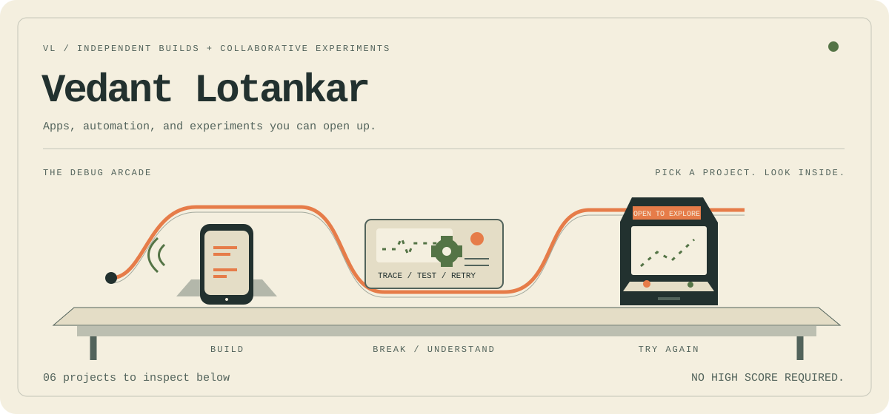

<picture>
  <source media="(prefers-color-scheme: dark)" srcset="assets/arcade-dark.svg">
  <source media="(prefers-color-scheme: light)" srcset="assets/arcade-light.svg">
  
</picture>

# Hey, I'm Vedant.

I build apps and automation, and experiment with machine learning. This is my workbench. Pick something, open it up, and see what makes it tick.

[Explore the builds](#pick-a-build) · [Try a debugging puzzle](#a-small-debugging-puzzle) · [Start a conversation](https://github.com/vedantLotankar/vedantLotankar/issues/new?title=Let%27s%20talk%20about%20a%20build)

**A quick look inside:** [five call-failure scenarios](https://github.com/rishi-sangare/bolna-call-lab#what-it-does) · [an eight-client mock demo](https://github.com/rishi-sangare/multi-account-game-automation#the-mock-client) · [a Swift location engine with fault-injection tests](https://github.com/rishi-sangare/elsewhere#develop)

These describe repository contents and documented demos, rather than independently rerun benchmarks.

## Pick a build

### 01 / ChefMate
**A cooking app with recipe discovery and contextual AI chat.**

My solo project. React Native, Expo, TypeScript, Zustand, and an Express backend. The repository includes recipe and chat screens, server-side AI integration, and setup instructions. It's an MVP with dummy recipe data and unfinished features.

[Open the repository →](https://github.com/vedantLotankar/ChefMate)

Open the cabinet: what to look for

The mobile app and backend are separate. Start with `src/` for the app and `backend/` for the server. The [package manifest](https://github.com/vedantLotankar/ChefMate/blob/main/package.json) records the current app dependencies. Some README setup and version claims need updating.

### 02 / ProTanki Commander
**One Windows app coordinating multiple game clients.**

Pair-built with [Rishi Sangare](https://github.com/rishi-sangare): shared design, implementation, testing, and debugging. Python, Qt, and Win32. The repository documents per-account state machines, click verification, fallback input, and a demo using eight mock clients.

[Repository](https://github.com/rishi-sangare/multi-account-game-automation) · [Recorded mock-client demo](https://github.com/rishi-sangare/multi-account-game-automation/blob/main/docs/media/demo.mp4)

Open the cabinet: what happens after a click?

The engine checks whether the screen changed, retries missed input, and can switch from background messages to real mouse input. The bundled mock can deliberately reject background clicks. The demo uses this stand-in, so it shouldn't be read as a live-game benchmark.

### 03 / Call Lab for Bolna
**Reproduce a dropped voice-agent call. Find the broken stage in the logs.**

Pair-built with [Rishi Sangare](https://github.com/rishi-sangare): shared design, implementation, testing, and debugging. Python, WebSockets, Bolna, and Twilio Media Streams. Five documented scenarios distinguish silence timeouts, TTS configuration, STT rejection, missing audio, and a corrected configuration.

[Repository](https://github.com/rishi-sangare/bolna-call-lab) · [Walkthrough page](https://rishi-sangare.github.io/bolna-call-lab/)

Open the cabinet: where is the evidence?

`engine/` runs the Bolna engine. `lab/` simulates the caller. `doctor/analyze.py` reads engine logs and caller events to identify which stage failed. The useful distinction is the reason for the drop, not just the fact that the call stopped.

### 04 / Wholesale Voice Desk
**A lead intake, qualification, and appointment-booking workflow.**

Pair-built with [Rishi Sangare](https://github.com/rishi-sangare): shared design, implementation, testing, and debugging. Vapi, Make.com, Python, and Supabase. The README documents a demo that routes a qualified lead and books a walkthrough, plus duplicate, consent, opt-out, and calling-hours branches.

[Repository](https://github.com/rishi-sangare/wholesale-voice-desk) · [Demo page](https://rishi-sangare.github.io/wholesale-voice-desk/)

Open the cabinet: follow the lead

Intake → normalize and deduplicate → consent and calling-hours checks → call or human task → post-call routing. Start with `src/make/`, `src/vapi/`, and `src/supabase/`. These are implemented workflow branches; they aren't a claim of legal certification.

### 05 / Elsewhere
**An experimental iPhone location-simulation app with route playback.**

Pair-built with [Rishi Sangare](https://github.com/rishi-sangare): shared design, implementation, testing, and debugging. Swift, SwiftUI, and a Python simulator bridge. The README distinguishes the working Simulator path from the real-device path that still needs testers.

[Repository](https://github.com/rishi-sangare/elsewhere) · [Test plan](https://github.com/rishi-sangare/elsewhere/blob/main/docs/TESTING.md)

Open the cabinet: how does it handle failure?

The pure-Swift engine includes a session supervisor, route playback, and fault-injection tests. The documented design checks the reported location and alerts on exposure or connection failure. Real-device reliability remains an explicit testing limitation.

**Also on the bench:** [Telegram Content Bot](https://github.com/rishi-sangare/telegram-content-bot-demo), pair-built with Rishi using Make.com for briefs, approvals, Drive upload detection, and Asana tasks. That repository holds the demo page and video.

## A small debugging puzzle

*A voice-agent call ends after about 12 seconds. The log says `inactivity_timeout`. What would you inspect next?*

A / Assume the speech-to-text account ran out of credit

Check the provider logs before deciding. In Call Lab's documented STT-rejection scenario, the termination reason is `transcriber_connection_error`. An inactivity timeout alone doesn't establish a billing problem.

B / Check audio flow, TTS configuration, and the silence timeout

That's the useful next step. Several different failures can end in inactivity: missing caller audio, a voice that never plays, or a healthy caller pausing longer than the configured timeout. Inspect each stage before changing settings.

[Look at the five scenarios →](https://github.com/rishi-sangare/bolna-call-lab#what-it-does)

C / Increase every timeout and call it fixed

That could hide a broken stage. Confirm that caller audio arrives and agent audio plays first. Call Lab includes a corrected configuration, but the right fix depends on what the logs show.

## More experiments

[Supervised learning](https://github.com/vedantLotankar/Supervised-Learning) · [Reinforcement learning](https://github.com/vedantLotankar/Reinforcement-Learning) · [Sign-language translation](https://github.com/vedantLotankar/WP_Project) · [Inventory management](https://github.com/vedantLotankar/Inventory_Management_System)

These are my solo repositories. Their documentation and evaluation details are being reviewed.

## Collaboration

For the five projects with Rishi, we worked together throughout: brainstorming, prototyping, pair coding, testing, debugging, and improving the builds. The project descriptions above refer to our shared work.

Want to discuss an implementation or build something together? [Open a profile issue](https://github.com/vedantLotankar/vedantLotankar/issues/new?title=Let%27s%20talk%20about%20a%20build).

The workshop illustration is animated; the cabinets and puzzle use GitHub's expandable sections. Everything still reads with images or motion turned off.

