<!-- Visual profile. Every linked panel opens its project. Text alternatives are included on each image. -->

<a href="https://github.com/vedantLotankar?tab=repositories">
  <picture>
    <source media="(prefers-color-scheme: dark)" srcset="assets/01-intro-dark.svg">
    <source media="(prefers-color-scheme: light)" srcset="assets/01-intro-light.svg">
    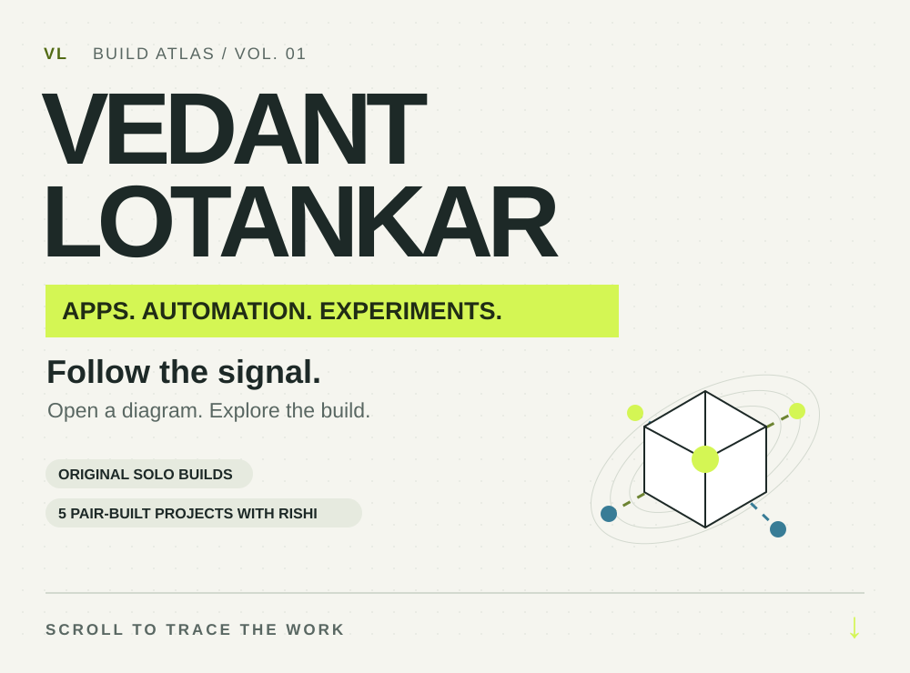
  </picture>
</a>

<a href="https://github.com/rishi-sangare/multi-account-game-automation">
  <picture>
    <source media="(prefers-color-scheme: dark)" srcset="assets/02-commander-dark.svg">
    <source media="(prefers-color-scheme: light)" srcset="assets/02-commander-light.svg">
    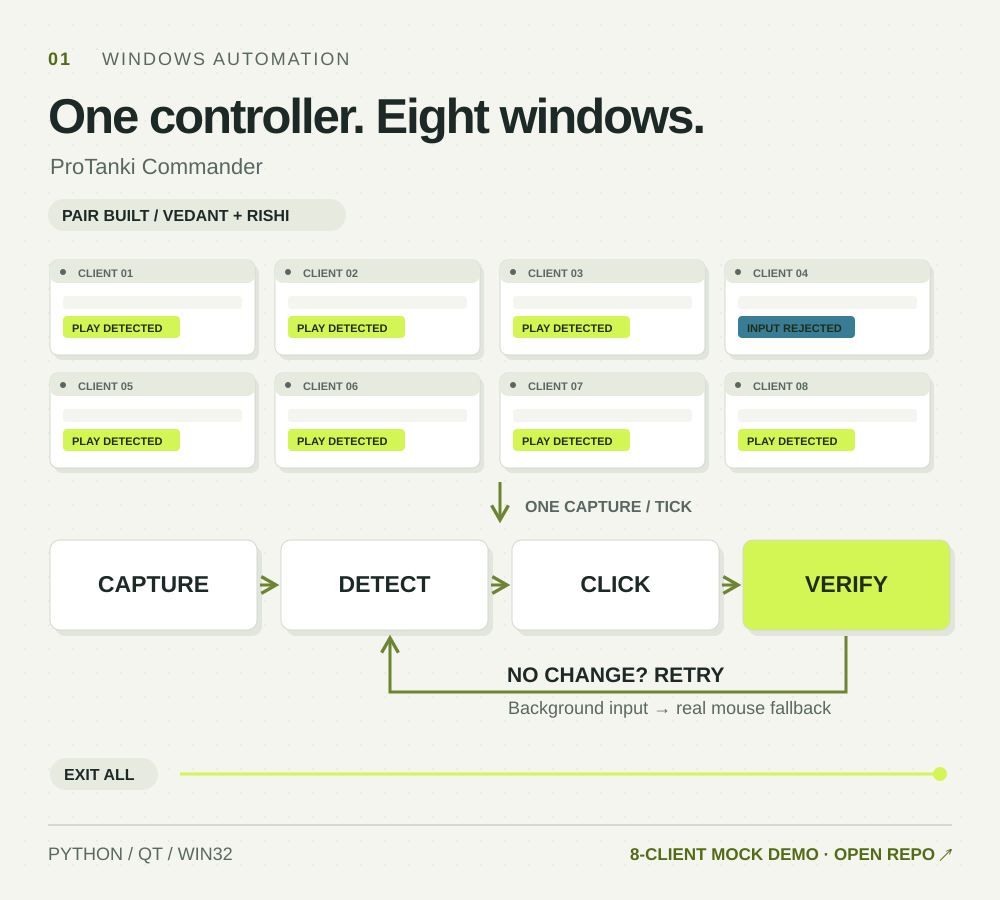
  </picture>
</a>

<a href="https://github.com/rishi-sangare/bolna-call-lab">
  <picture>
    <source media="(prefers-color-scheme: dark)" srcset="assets/03-call-lab-dark.svg">
    <source media="(prefers-color-scheme: light)" srcset="assets/03-call-lab-light.svg">
    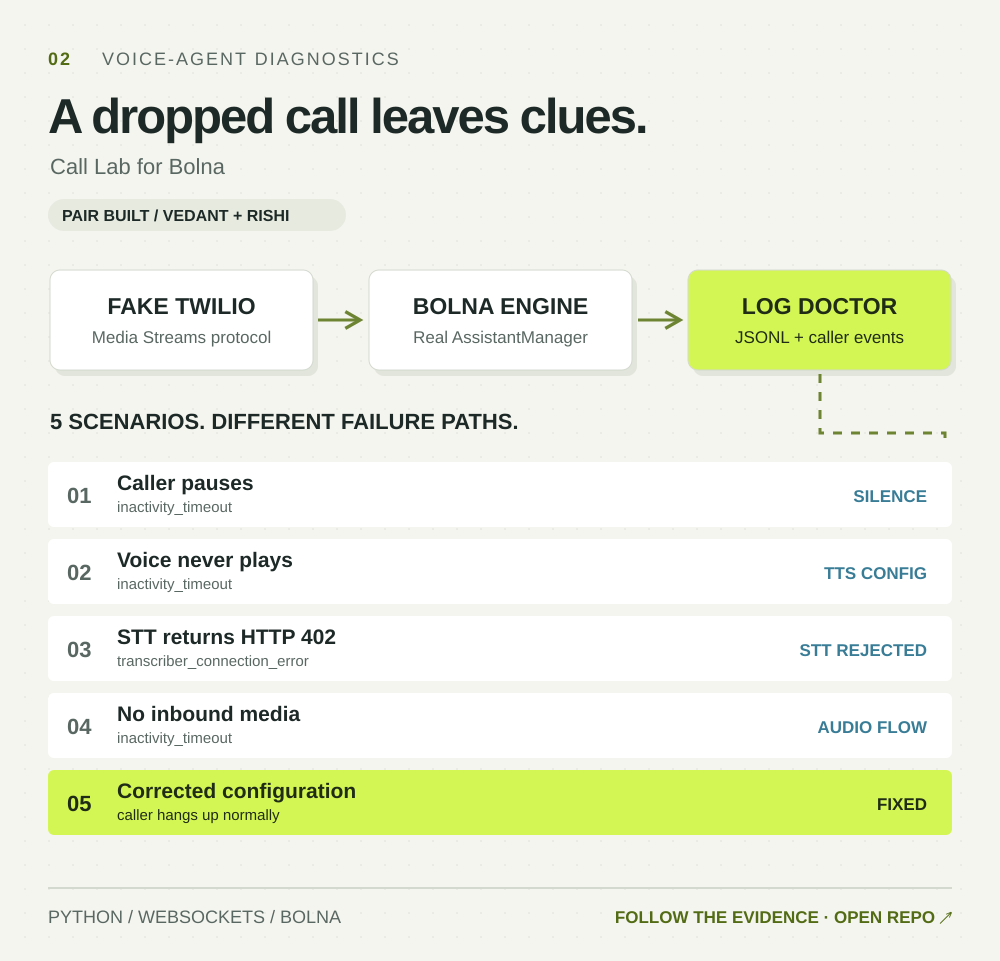
  </picture>
</a>

<a href="https://github.com/vedantLotankar/ChefMate">
  <picture>
    <source media="(prefers-color-scheme: dark)" srcset="assets/04-chefmate-dark.svg">
    <source media="(prefers-color-scheme: light)" srcset="assets/04-chefmate-light.svg">
    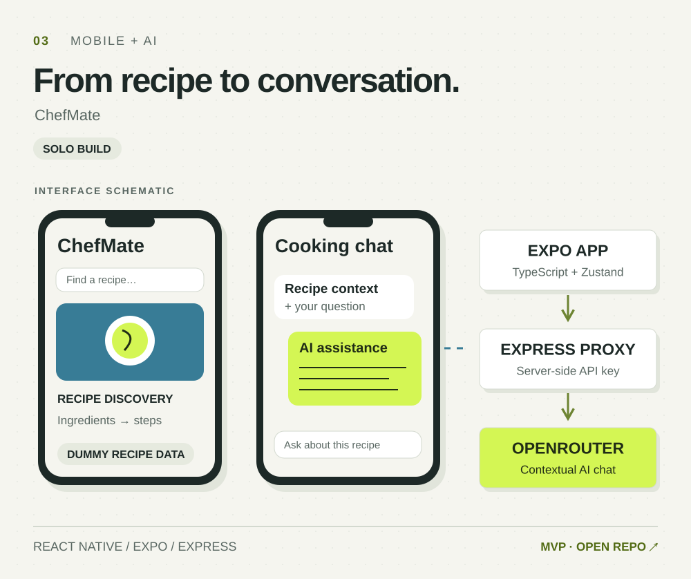
  </picture>
</a>

<a href="https://github.com/rishi-sangare/wholesale-voice-desk">
  <picture>
    <source media="(prefers-color-scheme: dark)" srcset="assets/05-voice-desk-dark.svg">
    <source media="(prefers-color-scheme: light)" srcset="assets/05-voice-desk-light.svg">
    
  </picture>
</a>

<a href="https://github.com/rishi-sangare/elsewhere">
  <picture>
    <source media="(prefers-color-scheme: dark)" srcset="assets/06-elsewhere-dark.svg">
    <source media="(prefers-color-scheme: light)" srcset="assets/06-elsewhere-light.svg">
    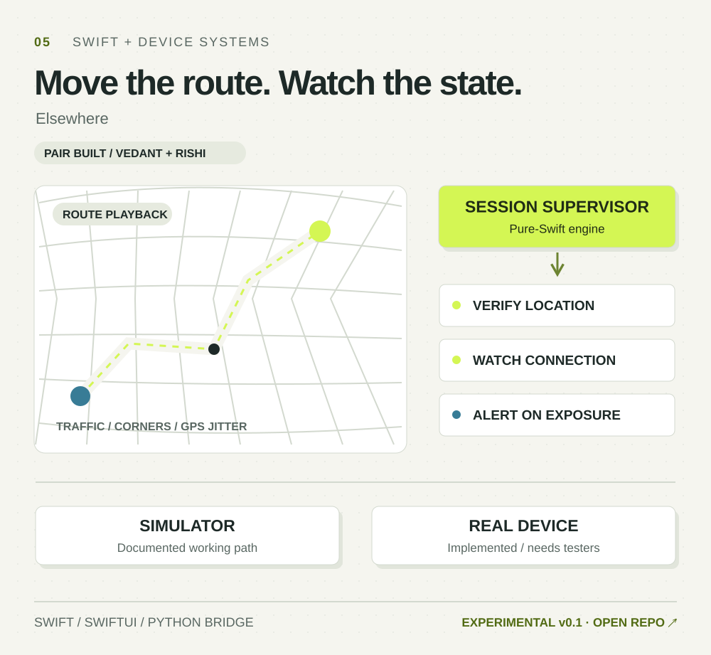
  </picture>
</a>

<a href="https://rishi-sangare.github.io/telegram-content-bot-demo/">
  <picture>
    <source media="(prefers-color-scheme: dark)" srcset="assets/07-content-bot-dark.svg">
    <source media="(prefers-color-scheme: light)" srcset="assets/07-content-bot-light.svg">
    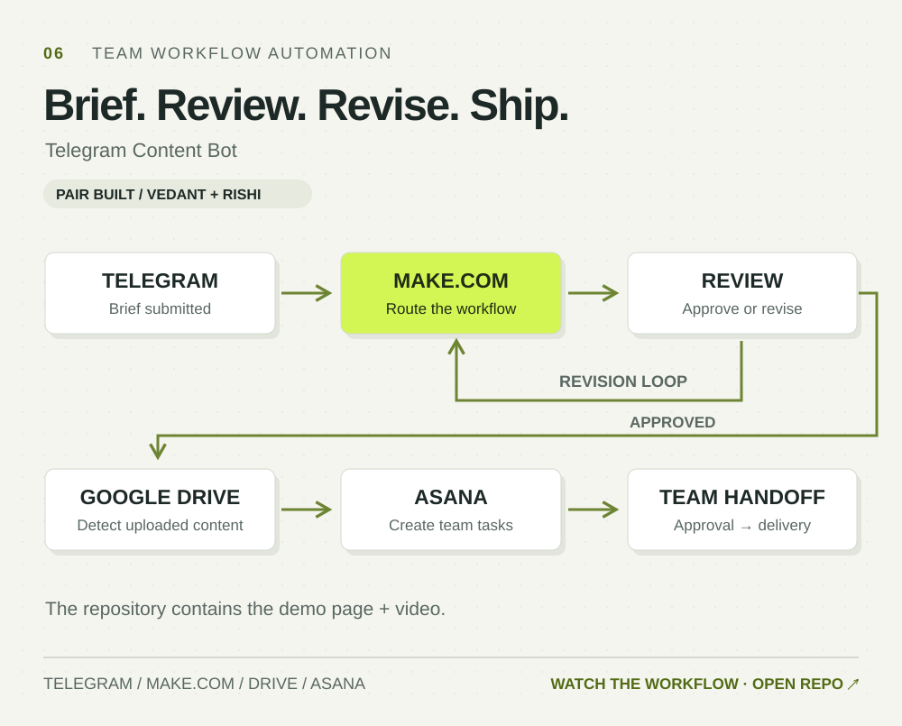
  </picture>
</a>

<picture><source media="(prefers-color-scheme: dark)" srcset="assets/09-challenge-dark.svg">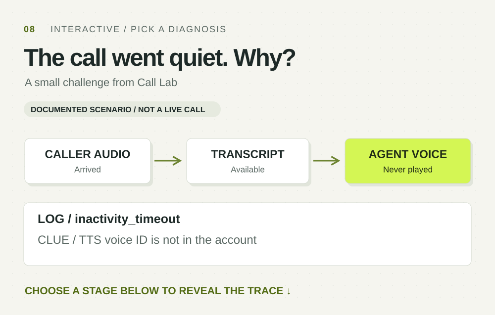</picture>

01 / Inspect speech-to-text

<picture><source media="(prefers-color-scheme: dark)" srcset="assets/answer-0-dark.svg">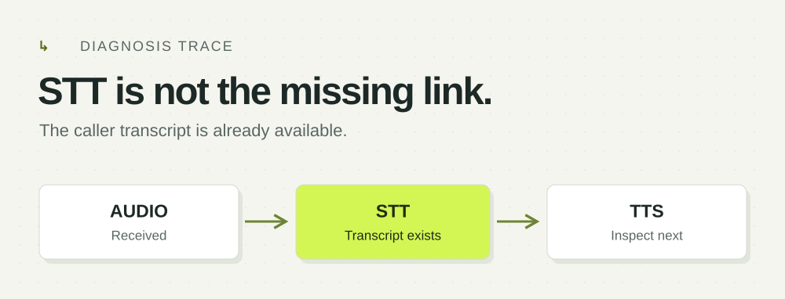</picture>

02 / Inspect text-to-speech

<picture><source media="(prefers-color-scheme: dark)" srcset="assets/answer-1-dark.svg">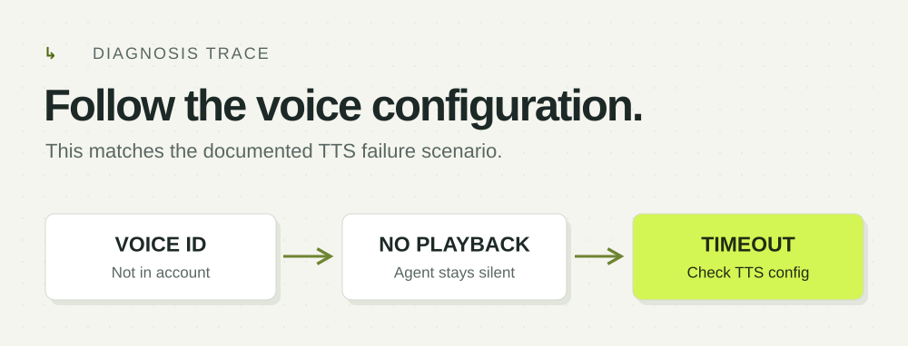</picture>

03 / Increase the timeout

<picture><source media="(prefers-color-scheme: dark)" srcset="assets/answer-2-dark.svg">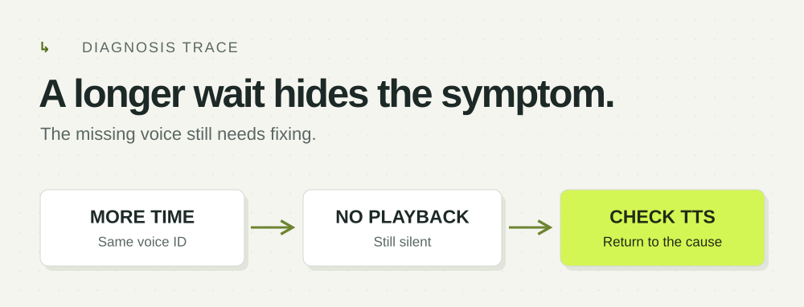</picture>

<a href="https://github.com/vedantLotankar/vedantLotankar/issues/new?title=Let%27s%20build%20something">
  <picture>
    <source media="(prefers-color-scheme: dark)" srcset="assets/08-experiments-dark.svg">
    <source media="(prefers-color-scheme: light)" srcset="assets/08-experiments-light.svg">
    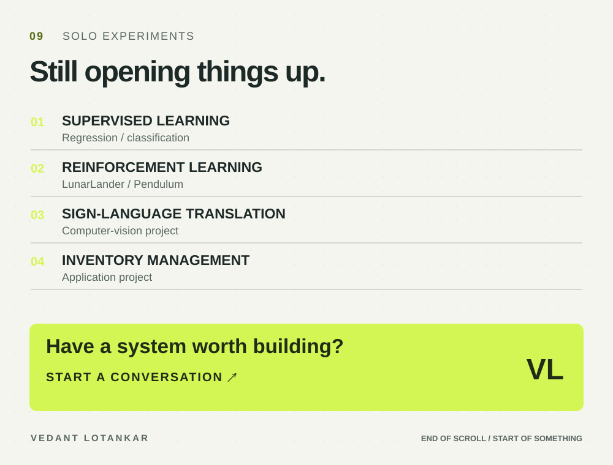
  </picture>
</a>

