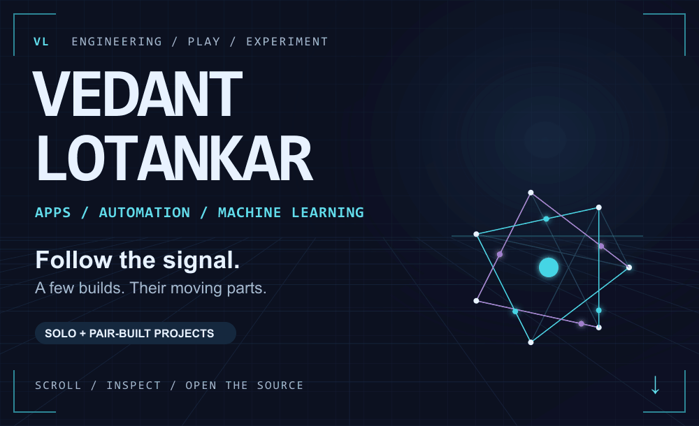
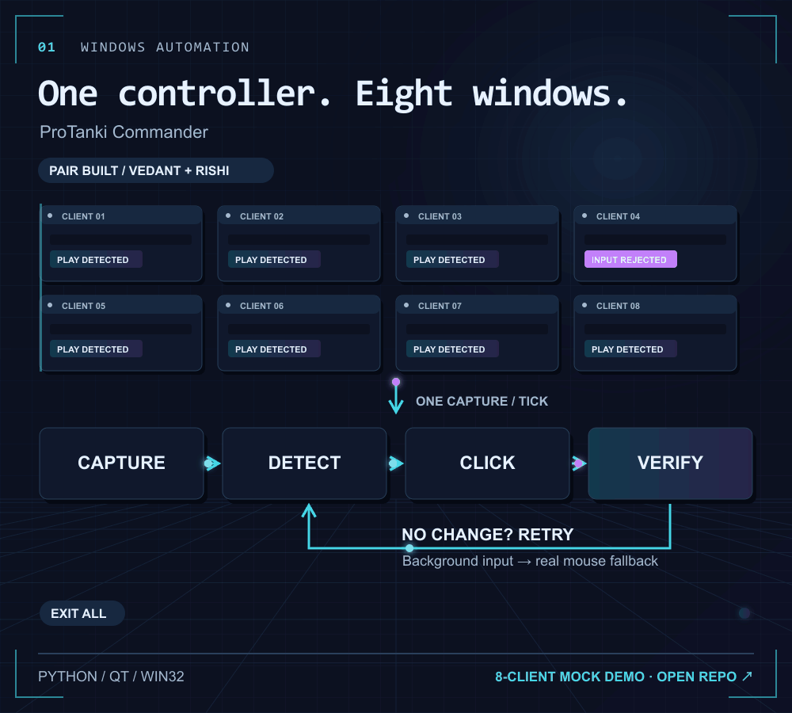
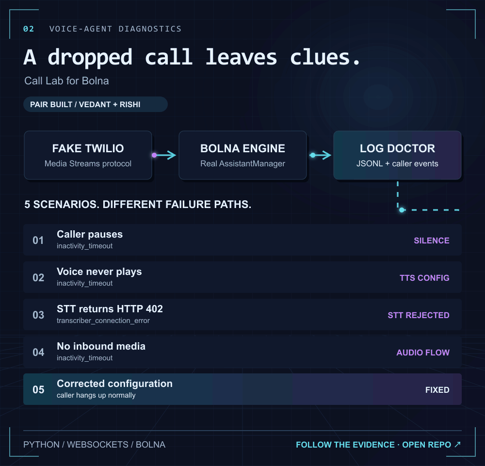
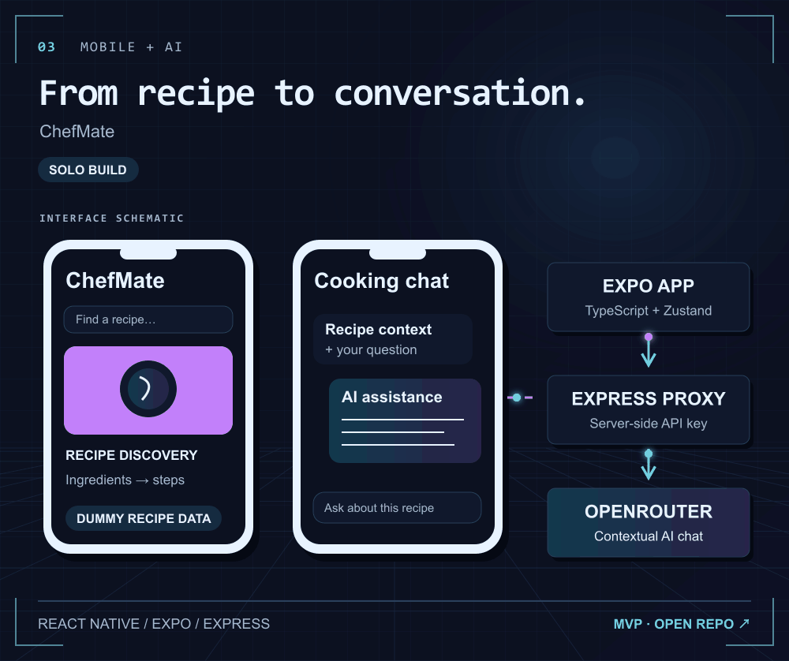
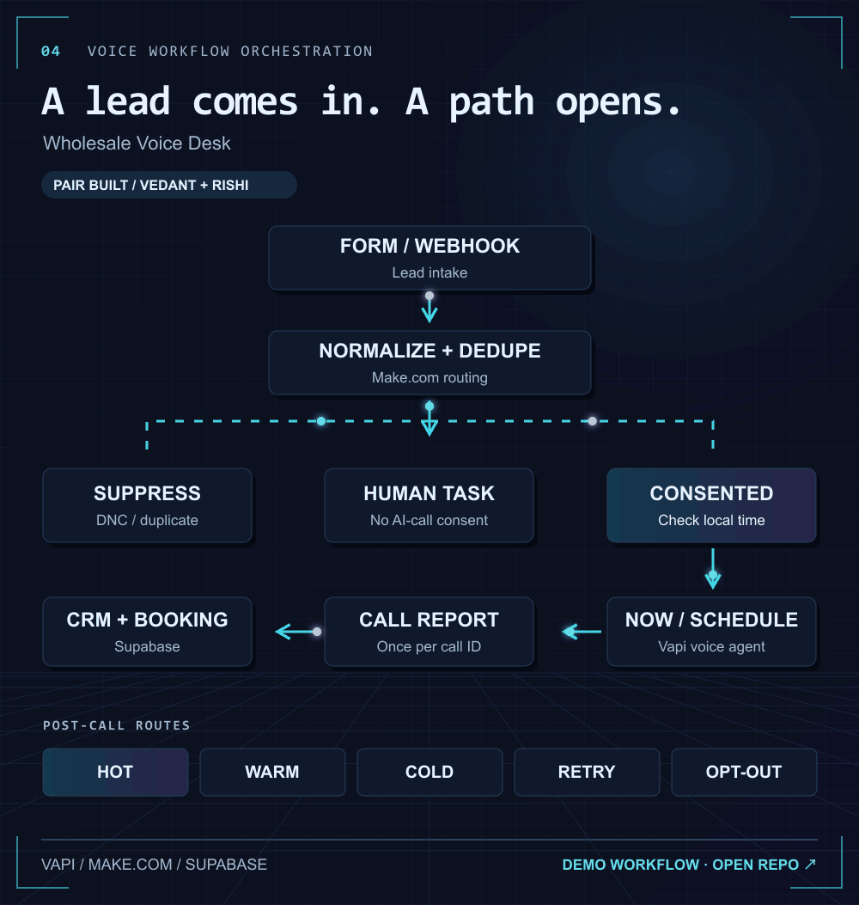
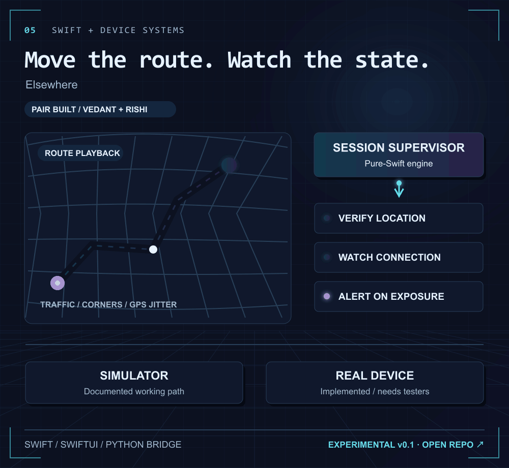

<a href="https://github.com/vedantLotankar?tab=repositories">
<picture>
<source media="(prefers-color-scheme: dark)" srcset="assets/00-signal-dark.gif">

</picture>
</a>

I build apps and automation, then work through what breaks. The shared projects below were pair-built with [Rishi Sangare](https://github.com/rishi-sangare), from design through debugging.

### 01 / ProTanki Commander
Eight mock clients, one controller. The interesting part is checking that each click actually worked.

<a href="https://github.com/rishi-sangare/multi-account-game-automation">
<picture>
<source media="(prefers-color-scheme: dark)" srcset="assets/02-commander-dark.gif">

</picture>
</a>

### 02 / Call Lab for Bolna
Same dropped call. Different causes. Trace the failed stage instead of guessing.

<a href="https://github.com/rishi-sangare/bolna-call-lab">
<picture>
<source media="(prefers-color-scheme: dark)" srcset="assets/03-call-lab-dark.gif">

</picture>
</a>

Quick diagnosis: a transcript exists, but the agent voice never plays. What next?

Check the TTS voice configuration and playback logs. Increasing the silence timeout can hide the broken stage. [Inspect the scenarios](https://github.com/rishi-sangare/bolna-call-lab#what-it-does).

### 03 / ChefMate · solo build
A cooking-assistant MVP connecting recipe context to AI chat.

<a href="https://github.com/vedantLotankar/ChefMate">
<picture>
<source media="(prefers-color-scheme: dark)" srcset="assets/04-chefmate-dark.gif">

</picture>
</a>

### 04 / Wholesale Voice Desk
Lead intake, consent checks, call routing and CRM handoff as one workflow.

<a href="https://github.com/rishi-sangare/wholesale-voice-desk">
<picture>
<source media="(prefers-color-scheme: dark)" srcset="assets/05-voice-desk-dark.gif">

</picture>
</a>

### 05 / Elsewhere
Route playback with a session supervisor. Simulator path documented; real-device testing remains open.

<a href="https://github.com/rishi-sangare/elsewhere">
<picture>
<source media="(prefers-color-scheme: dark)" srcset="assets/06-elsewhere-dark.gif">

</picture>
</a>

**Also built:** [Telegram Content Bot](https://github.com/rishi-sangare/telegram-content-bot-demo) with Rishi · [ML experiments](https://github.com/vedantLotankar/Supervised-Learning) · [Reinforcement learning](https://github.com/vedantLotankar/Reinforcement-Learning).

[Talk about a build →](https://github.com/vedantLotankar/vedantLotankar/issues/new?title=Let%27s%20build%20something)
